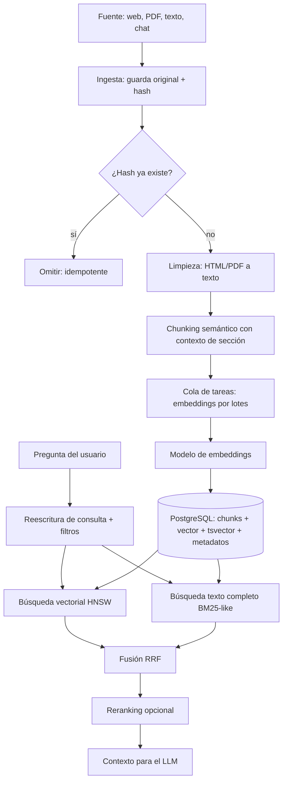

# Paso 1 [Architect Agent]: base vectorial y pipeline de embeddings

## 1. Decisión: pgvector vs Qdrant vs Pinecone

| Opción | A favor | En contra | Encaje con Elyntro |
|---|---|---|---|
| **PostgreSQL + pgvector (Supabase)** | Ya usáis Supabase; una sola base de datos para usuarios, chats y vectores; SQL permite filtros por metadatos y búsqueda por texto en la misma consulta; coste incluido en el plan | Menos eficiente que un motor dedicado a escala de decenas de millones de vectores | **Recomendada para empezar** |
| Qdrant | Muy rápido, filtrado avanzado, se puede autoalojar | Otro servicio que mantener y pagar; hay que sincronizar con Supabase | Plan B si se supera el millón de fragmentos con latencia mala |
| Pinecone | Totalmente gestionado | Coste recurrente que crece con el uso; datos fuera de vuestro control | No encaja con "sin gasto recurrente que no pueda medir" |

Motivo breve: menos piezas, menos coste, y las búsquedas híbridas (palabras clave + significado) se hacen bien en PostgreSQL. Migrar a Qdrant más tarde es posible porque el esquema separa documentos, fragmentos y embeddings.

Cómo funciona un embedding (por si ayuda): es una lista de números que representa el significado de un texto; textos parecidos quedan "cerca" en el espacio numérico.

## 2. Diagrama del pipeline



## 3. Esquema SQL (PostgreSQL 15+ con pgvector 0.7+)

Dimensión del vector: **1024** como valor de ejemplo. Debe coincidir con el modelo de embeddings elegido; cambiarlo implica reindexar.

```sql
create extension if not exists vector;
create extension if not exists pg_trgm;

-- Documentos de origen
create table documents (
  id            uuid primary key default gen_random_uuid(),
  owner_id      uuid not null references auth.users(id) on delete cascade,
  source_type   text not null check (source_type in ('web','pdf','text','chat','file')),
  source_uri    text,
  title         text,
  language      text default 'es',
  content_hash  text not null,
  metadata      jsonb not null default '{}'::jsonb,   -- etiquetas, autor, tema...
  created_at    timestamptz not null default now(),
  updated_at    timestamptz not null default now(),
  unique (owner_id, content_hash)
);

-- Fragmentos (unidad de búsqueda)
create table chunks (
  id            uuid primary key default gen_random_uuid(),
  document_id   uuid not null references documents(id) on delete cascade,
  owner_id      uuid not null references auth.users(id) on delete cascade,
  position      int  not null,                 -- orden dentro del documento
  section_path  text[],                        -- ej. {'Capítulo 2','Precios'}
  content       text not null,
  token_count   int  not null,
  embedding     vector(1024),                  -- se rellena tras la cola de embeddings
  embedding_model text,                        -- para saber con qué modelo se generó
  fts           tsvector generated always as (to_tsvector('spanish', content)) stored,
  metadata      jsonb not null default '{}'::jsonb,
  created_at    timestamptz not null default now(),
  unique (document_id, position)
);

-- Índices
create index chunks_embedding_hnsw on chunks using hnsw (embedding vector_cosine_ops)
  with (m = 16, ef_construction = 64);
create index chunks_fts_gin      on chunks using gin (fts);
create index chunks_metadata_gin on chunks using gin (metadata jsonb_path_ops);
create index chunks_owner_idx    on chunks (owner_id);
create index documents_metadata_gin on documents using gin (metadata jsonb_path_ops);

-- Seguridad por fila: cada usuario solo ve lo suyo
alter table documents enable row level security;
alter table chunks    enable row level security;
create policy documents_owner on documents using (owner_id = auth.uid());
create policy chunks_owner    on chunks    using (owner_id = auth.uid());

-- Búsqueda híbrida: vector + texto, fusionados con Reciprocal Rank Fusion (RRF)
create or replace function hybrid_search(
  query_text      text,
  query_embedding vector(1024),
  match_count     int   default 10,
  metadata_filter jsonb default '{}'::jsonb,
  rrf_k           int   default 60,
  full_weight     float default 1.0,
  vec_weight      float default 1.0
)
returns table (chunk_id uuid, document_id uuid, content text, score float)
language sql stable
as $$
  with vec as (
    select id, row_number() over (order by embedding <=> query_embedding) as rank
    from chunks
    where metadata @> metadata_filter and embedding is not null
    order by embedding <=> query_embedding
    limit match_count * 4
  ),
  txt as (
    select id, row_number() over (order by ts_rank_cd(fts, q) desc) as rank
    from chunks, websearch_to_tsquery('spanish', query_text) q
    where fts @@ q and metadata @> metadata_filter
    order by ts_rank_cd(fts, q) desc
    limit match_count * 4
  ),
  fused as (
    select coalesce(v.id, t.id) as id,
           coalesce(vec_weight  / (rrf_k + v.rank), 0) +
           coalesce(full_weight / (rrf_k + t.rank), 0) as score
    from vec v full outer join txt t on v.id = t.id
  )
  select c.id, c.document_id, c.content, f.score
  from fused f join chunks c on c.id = f.id
  order by f.score desc
  limit match_count;
$$;
```

Notas:
- La función respeta RLS cuando se llama con el token del usuario (no con la clave de servicio).
- `metadata_filter` permite búsquedas como `{"tema":"finanzas","idioma":"es"}`.
- No se ha ejecutado contra una base real: es un diseño pendiente de probar en una base de pruebas.

## 4. Tipos TypeScript estrictos

```ts
export type SourceType = 'web' | 'pdf' | 'text' | 'chat' | 'file';

export interface DocumentRecord {
  id: string;
  ownerId: string;
  sourceType: SourceType;
  sourceUri?: string;
  title?: string;
  language: string;
  contentHash: string;
  metadata: Record<string, string | number | boolean | string[]>;
}

export interface Chunk {
  id: string;
  documentId: string;
  position: number;
  sectionPath: readonly string[];
  content: string;
  tokenCount: number;
  embedding?: readonly number[];
  embeddingModel?: string;
  metadata: Record<string, string | number | boolean | string[]>;
}

export interface HybridSearchRequest {
  queryText: string;
  matchCount: number;                 // 1..50
  metadataFilter?: Record<string, unknown>;
  weights?: { vector: number; fulltext: number };
}

export interface SearchHit {
  chunkId: string;
  documentId: string;
  content: string;
  score: number;
}

export interface EmbeddingProvider {
  readonly model: string;
  readonly dimensions: number;        // debe coincidir con vector(N)
  embed(texts: readonly string[]): Promise<number[][]>;
}
```

## 5. Estrategia de embeddings

- **Modelo**: opción abierta preferida (por vuestra prioridad de coste), por ejemplo familia BGE-M3 o multilingual-e5, ejecutable en un servicio externo barato o en CPU para volumen bajo. Alternativa de pago por uso: API de embeddings de un proveedor. Decisión pendiente de medir calidad en español con vuestros propios textos.
- **Lotes**: 64-128 fragmentos por petición, con reintentos y cola (BullMQ o tabla de tareas en Supabase).
- **Versionado**: se guarda `embedding_model`; al cambiar de modelo se reindexa en segundo plano y se cambia el índice cuando termina.
- **Tamaño de fragmento**: 300-500 tokens con 10-15 % de solapamiento, cortando por límites semánticos (párrafos, títulos).

## 6. Costes y latencia (estimaciones, no medidas)

Fórmula de coste de ingesta: `tokens_totales × precio_por_token_del_modelo`. Ejemplo ilustrativo: 1 millón de tokens de documentos = unos 2.000-3.000 fragmentos de 400 tokens. El precio depende del modelo elegido; con un modelo abierto autoalojado el coste marginal es de cómputo, no por token.

Latencia orientativa por consulta (a validar con pruebas reales):
- Embedding de la pregunta: decenas a pocos cientos de ms según el proveedor.
- Búsqueda híbrida en PostgreSQL con índice HNSW y menos de ~1 millón de fragmentos: normalmente decenas de ms.
- Reranking opcional: +100-300 ms.
- Total antes de llamar al LLM: del orden de 0,2-0,6 s.

Coste en tokens al LLM por respuesta: `fragmentos × tamaño` (ej. 6 × 400 = 2.400 tokens de contexto) más pregunta y respuesta.

## 7. Pendientes antes de implementar
1. Elegir modelo de embeddings tras una prueba de calidad en español.
2. Probar el SQL en una rama de base de datos de Supabase, no en producción.
3. Confirmar el plan de Supabase y el límite de almacenamiento.
