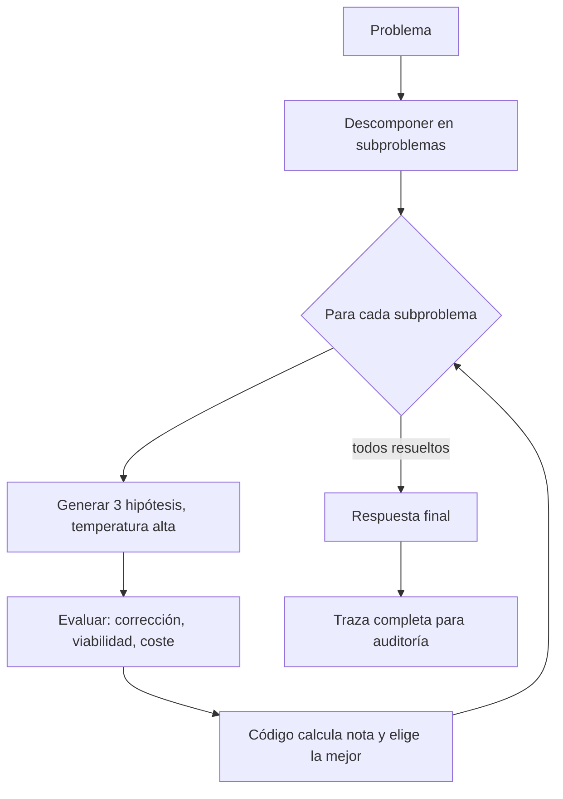

# Paso 2 [Architect Agent]: bucle de razonamiento

Código: `reasoning-loop.ts` (referencia, no incluido en el repo) (TypeScript, tipado estricto). Prueba: `reasoning-loop.test.ts`.

## Cómo funciona (en lenguaje llano)
1. **Descomponer**: el modelo divide el problema en hasta 5 subproblemas.
2. **Hipotetizar**: para cada subproblema propone exactamente 3 soluciones distintas.
3. **Evaluar**: puntúa cada una de 0 a 10 en corrección, viabilidad y coste. La nota total la calcula el código con pesos fijos (50 % corrección, 30 % viabilidad, 20 % coste), no el modelo.
4. **Elegir**: gana la de mayor nota; en empate, la más correcta.
5. **Responder**: redacta la respuesta final usando solo las soluciones elegidas.

Por qué la nota la calcula el código: evita que el modelo "se convenza" a sí mismo y hace el resultado reproducible y auditable.

## Control de costes
- Tope duro `maxLlmCalls` (30 por defecto): si se supera, el bucle se detiene con error en vez de gastar sin límite.
- Llamadas por problema con N subproblemas: `1 + 2N + 1`. Con 5 subproblemas son 12 llamadas.
- Tokens aproximados por llamada (máximos configurados): descomposición 800, hipótesis 900, evaluación 900, final 1500.
- Estimación de techo de salida con 5 subproblemas: 800 + 5×(900+900) + 1500 = **11.300 tokens de salida**, más los de entrada (que crecen con el contexto acumulado). Es una cota superior de configuración, no una medida real.
- Latencia: llamadas en secuencia; si cada una tarda unos 3-8 s, el total es del orden de 40-100 s. Estimación, a medir. Mejora posible: las hipótesis de subproblemas independientes (`dependsOn` vacío) se podrían paralelizar.

## Pruebas
La prueba usa un modelo falso (`FakeLLM`), así que no gasta créditos ni toca n8n. Comprueba: 2 subproblemas, elección correcta de la hipótesis ganadora, número exacto de llamadas (6) y extracción de JSON rodeado de texto.

## Límites conocidos
- La calidad real depende del modelo conectado; la prueba solo valida la lógica, no la inteligencia.
- Si el modelo devuelve JSON inválido, el bucle lanza error (no reintenta todavía). Mejora propuesta: un reintento con el mensaje de error.
- Conexión a n8n: se implementa `LLM.complete` llamando al webhook del agente. Pendiente de definir cuando los créditos de n8n estén resueltos.
