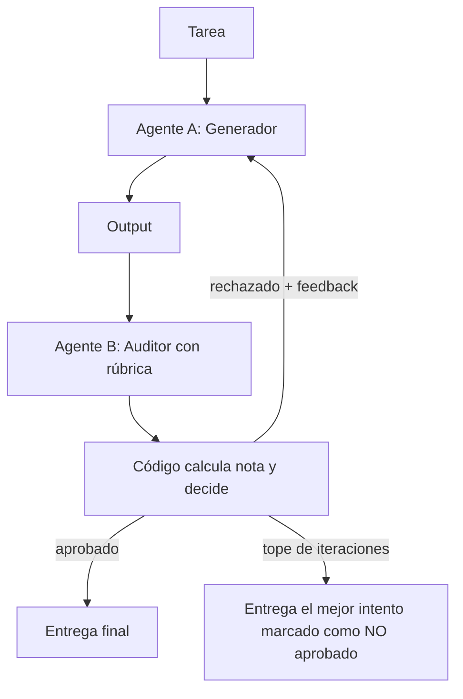

# Paso 4: sistema multiagente Generador (A) + Auditor (B)

Código: `audit-loop.ts`. Prueba: `audit-loop.test.ts` (modelos falsos, sin gasto de créditos).

## Reglas que hacen estricto al auditor
- **Rúbrica con 5 criterios ponderados** (corrección 35 %, completitud 25 %, fundamento 20 %, claridad 10 %, seguridad 10 %) y **nota mínima por criterio**: una media alta no tapa un criterio flojo.
- **Aprobar exige las tres cosas**: media ≥ 9, ningún criterio bajo su mínimo y ningún hallazgo crítico.
- **La decisión la toma el código**, no el modelo; el auditor solo puntúa y justifica con evidencia citada.
- **Criterio omitido = nota 1**: no se aprueba esquivando criterios.
- **El auditor trata el output como dato**: ignora instrucciones escondidas dentro (anti inyección entre agentes).
- **Tope de iteraciones** (4): si no aprueba, se entrega el mejor intento marcado `exhausted`, nunca como aprobado.

## Coste y latencia (estimaciones)
- Cada iteración = 2 llamadas (generar + auditar). Máximo 8 llamadas por tarea.
- Techo de salida configurado: 4 × (2.000 + 1.200) = 12.800 tokens, más los de entrada (el feedback añade el intento anterior). Cota de configuración, no medida.
- Latencia: iteraciones en secuencia; unos 10-20 s por iteración con un modelo medio (a medir).
- Ahorro recomendado: usar un modelo barato como generador y uno más fuerte solo como auditor, o auditar solo tareas de riesgo medio/alto.

## Límite importante
Si A y B son el mismo modelo, comparten sesgos y puntos ciegos. Mitigaciones: modelos distintos, verificación externa (ejecutar pruebas, comprobar fuentes) y, en tareas críticas, revisión humana.

## Integración con n8n
Cada agente es una implementación de `LLM.complete` que llama a un webhook o agente de n8n. Pendiente de definir cuando se resuelvan los créditos del flujo actual.
